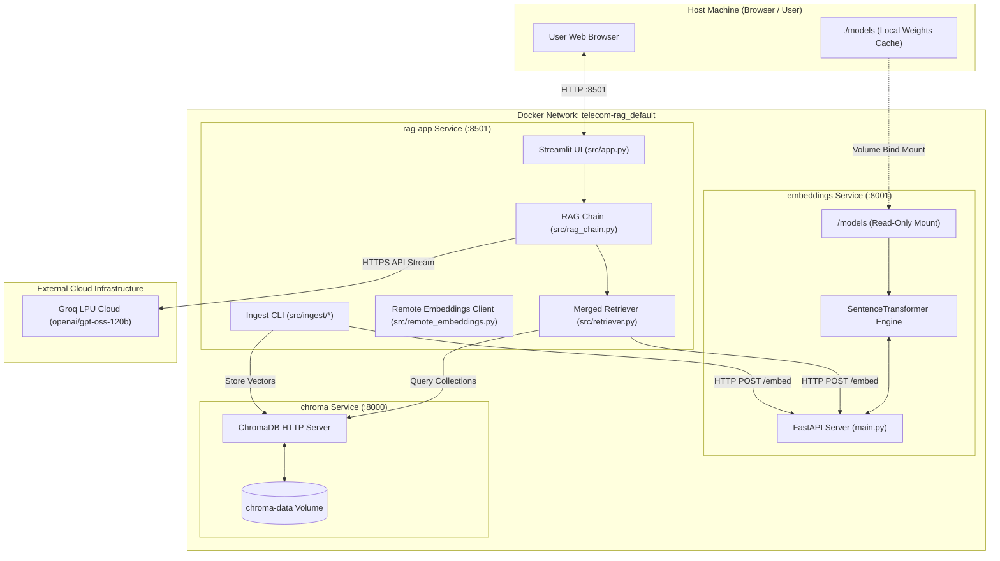
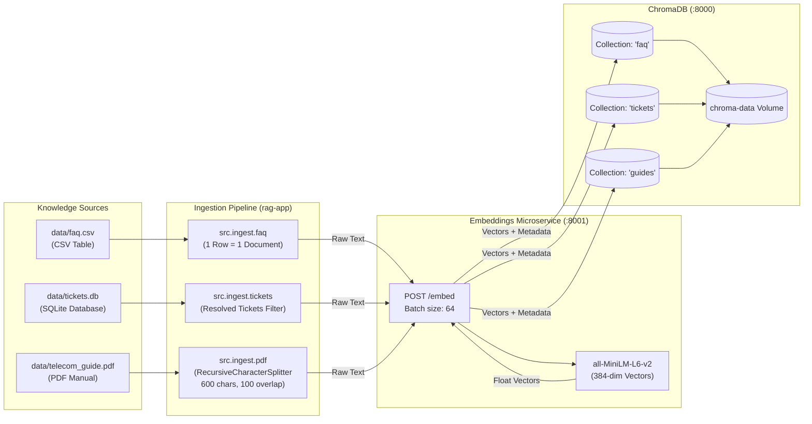
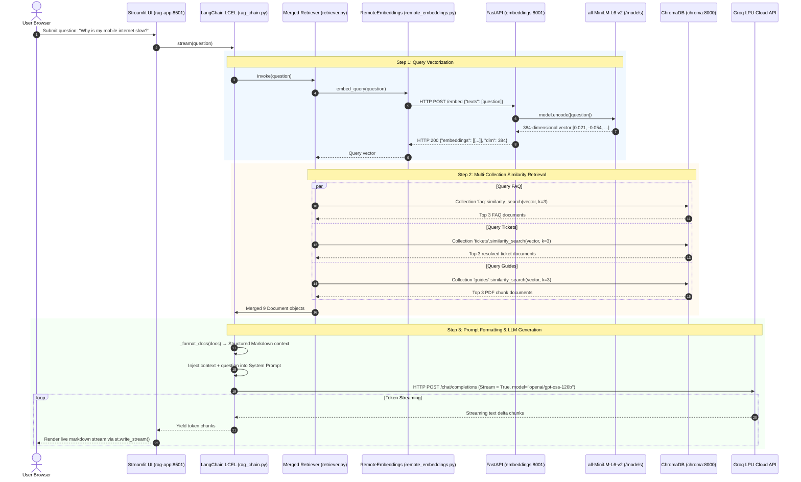

# Telecom RAG Chatbot — Architecture & Technical Specifications

This document provides a comprehensive technical breakdown of the multi-container **Telecom RAG (Retrieval-Augmented Generation) Chatbot** located in `6-telecom-rag/`.

---

## 1. System Overview & Container Topology

The application decomposes a RAG pipeline into three independent, decoupled microservices connected over an internal Docker bridge network (`telecom-rag_default`), with external inference handled by the Groq LPU Cloud.



---

## 2. Component Breakdown

| Container / Service | Base Image | Port | Memory Limit | Primary Purpose |
|---|---|---|---|---|
| **`rag-app`** | `python:3.12-slim` | `8501:8501` | `2GB` | Streamlit chat UI, LangChain orchestration, document ingestion, and external Groq API communication. |
| **`embeddings`** | `python:3.12-slim` *(or PyTorch CUDA for GPU)* | `8001` (internal) | `3GB` (CPU) / `6GB` (GPU) | Dedicated embedding microservice. Loads `sentence-transformers/all-MiniLM-L6-v2` into memory once and computes 384-dimensional dense vectors on demand over HTTP. |
| **`chroma`** | `chromadb/chroma:latest` | `8000` (internal) | Default | Vector database that stores document chunks, metadata, and embeddings across three distinct collections (`faq`, `tickets`, `guides`). Persists data to `chroma-data`. |

---

## 3. Detailed File Catalog

### Project Root (`6-telecom-rag/`)

| File | Purpose |
|---|---|
| **`compose.yaml`** | Core Docker Compose configuration declaring the three services (`embeddings`, `chroma`, `rag-app`), resource constraints (`mem_limit`), port bindings, environment variables, volume mappings, and container dependencies. |
| **`compose.gpu.yaml`** | Docker Compose override file that swaps `embeddings` with an NVIDIA CUDA runtime image (`Dockerfile.gpu`) and reserves all available GPU devices. |
| **`download_model_host.py`** | Host-side helper script. Downloads all 8 model configuration, tokenizer, and weight files directly from Hugging Face into `./models` on the host machine, bypassing corporate proxy and container restrictions. |
| **`models/`** | Directory containing pre-downloaded `all-MiniLM-L6-v2` model weights and configs (`model.safetensors`, `config.json`, `tokenizer.json`, etc.). Mounted into the container at `/models:ro`. |

---

### Embedding Microservice (`6-telecom-rag/embedding-service/`)

| File | Purpose |
|---|---|
| **`main.py`** | FastAPI application exposing `/embed` (generates embeddings for a batch of strings) and `/health`. Detects if `/models/config.json` exists locally and loads offline; otherwise falls back to the Hub name. |
| **`Dockerfile`** | Multi-stage, CPU-optimized container definition using Astral `uv` for fast package management. Pre-configures corporate proxy environment flags (`UV_INSECURE_HOST`). |
| **`Dockerfile.gpu`** | GPU-accelerated container definition based on `pytorch/pytorch:2.14.1-cuda12.6-cudnn9-runtime`. |
| **`pyproject.toml`** | Python project definition pinning `fastapi`, `uvicorn`, `sentence-transformers`, and CPU PyTorch wheels (`https://download.pytorch.org/whl/cpu`). |
| **`uv.lock`** | Fully resolved, cryptographically hashed dependency lockfile for deterministic container builds. |
| **`.dockerignore`** | Prevents `.venv`, build artifacts, and local cache files from entering the Docker build context. |

---

### RAG Application (`6-telecom-rag/rag-app/`)

| File | Purpose |
|---|---|
| **`src/app.py`** | Streamlit web application. Renders chat messages, interactive sample question sidebar buttons, handles user input, and streams assistant replies using `st.write_stream()`. |
| **`src/rag_chain.py`** | Defines the LangChain LCEL pipeline (`retriever | prompt | llm | parser`). Configures `ChatGroq` (`openai/gpt-oss-120b`) with a proxy-tolerant HTTP client (`verify=False`). |
| **`src/retriever.py`** | Builds a unified multi-collection retriever. Queries ChromaDB for top `k=3` relevant matches from `faq`, `tickets`, and `guides`, then merges them into a single context block. |
| **`src/remote_embeddings.py`** | Custom LangChain `Embeddings` client that delegates `embed_documents` and `embed_query` calls to the `embeddings` microservice (`http://embeddings:8001/embed`) with detailed connection error handling. |
| **`src/main.py`** | Alternative terminal/CLI chat interface for testing the RAG pipeline directly without Streamlit. |
| **`src/ingest/faq.py`** | Ingestion worker: parses `data/faq.csv`, generates embeddings via `remote_embeddings.py`, and stores them in ChromaDB collection `faq`. |
| **`src/ingest/tickets.py`** | Ingestion worker: queries resolved tickets from SQLite `data/tickets.db`, generates embeddings, and stores them in ChromaDB collection `tickets`. |
| **`src/ingest/pdf.py`** | Ingestion worker: loads `data/telecom_guide.pdf`, applies `RecursiveCharacterTextSplitter` (chunk size 600, overlap 100), generates embeddings, and stores them in ChromaDB collection `guides`. |
| **`data/faq.csv`** | Structured Q&A dataset of telecom policies, roaming rules, and billing guidelines. |
| **`data/tickets.db`** | SQLite database containing real-world customer support tickets with problem descriptions and resolutions. |
| **`data/telecom_guide.pdf`** | Comprehensive customer manual detailing APN setup, eSIM activation, Wi-Fi calling, and hardware troubleshooting. |
| **`.env.example`** | Template environment file documenting `GROQ_API_KEY`. |
| **`.env`** | Local secrets file holding the active `GROQ_API_KEY` (git-ignored). |

---

## 4. Data Ingestion Architecture & Dataflow

Ingestion is executed once (or upon data changes) via isolated ephemeral containers:
```bash
docker compose run --rm rag-app python -m src.ingest.<faq|tickets|pdf>
```



---

## 5. Sequential Query Execution Diagram

The diagram below details the exact lifecycle of a user query from the moment it is entered in Streamlit until the LLM response streams back.



---

## 6. Docker Networking, Storage & Secrets Architecture

### Networking (`telecom-rag_default`)
- **DNS Service Discovery**: Containers resolve each other using their Compose service names:
  - `rag-app` connects to `http://embeddings:8001` via `EMBEDDING_URL`.
  - `rag-app` connects to `http://chroma:8000` via `CHROMA_HOST` and `CHROMA_PORT`.
- **Port Exposure**:
  - Only port `8501` (`rag-app`) is bound to the host network (`"8501:8501"`), ensuring the internal vector database and embedding services remain inaccessible from outside the Docker host.

### Storage & Volumes
1. **Named Volume: `chroma-data`**:
   - Mapped to `/chroma/chroma` inside the `chroma` container.
   - Retains embedded collections across container restarts (`docker compose down && docker compose up`).
2. **Bind Mount: `./models:/models:ro`**:
   - Maps the local host directory `6-telecom-rag/models` directly into `/models` inside the `embeddings` container as read-only.
   - Eliminates model weight redownloads on container rebuilds and circumvents container-level corporate proxy restrictions.

### Secrets Management
- `GROQ_API_KEY` is loaded from `rag-app/.env` through Compose's `env_file` block:
  ```yaml
  env_file:
    - path: ./rag-app/.env
      required: false
  ```
- `.env` is explicitly ignored in `.gitignore` to prevent secret leakage.
